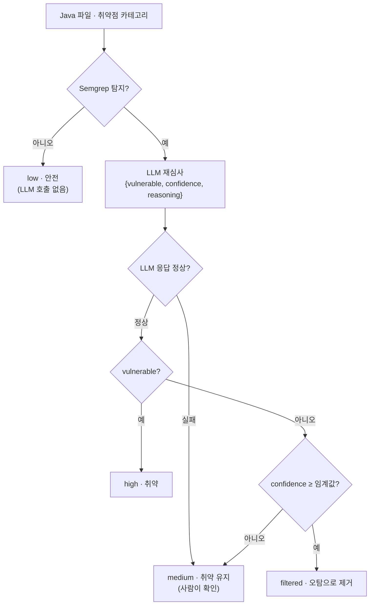
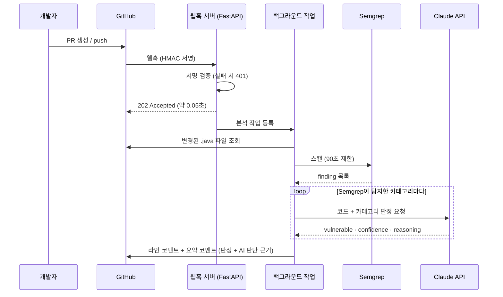

# 정적분석-LLM 캐스케이드 기반 보안 취약점 탐지 시스템

> **Semgrep이 넓게 잡고, LLM이 다시 심사하고, 판단 근거까지 PR에 남긴다.**
> 정적분석 도구의 오탐을 정탐 손실 없이 줄이기 위해 Semgrep과 LLM(Claude)을 캐스케이드로 결합했습니다. 그 결과를 GitHub Pull Request 자동 보안 리뷰 서비스로 배포한 동국대학교 컴퓨터공학과 졸업 프로젝트입니다.

<br>

## 📌 핵심 결과

| 지표 | 결과 |
|---|---|
| 오탐 감소 | **453건 → 238건 (−47.5%)**, 정탐 손실 **0건** |
| 정밀도 | 4개 취약점 유형 **모두에서 최고** (예: XSS 0.652 → **0.860**) |
| held-out 검증 | OR 결합 대비 F1 **+0.04 ~ 0.09**, 오탐 409 → 169건 (−58.7%) |
| 실서비스 | 웹훅 응답 **0.047초**, PR 분석부터 코멘트 게시까지 **약 1분** |
| 자동 테스트 | **102개 전부 통과** (블랙박스 15 + 화이트박스 87), 결함 주입 6종 모두 검출 |

> 평가 데이터: OWASP Benchmark v1.2 Java, 4개 유형 1,478건 (SQL 인젝션 CWE-89 · XSS CWE-79 · 명령어 인젝션 CWE-78 · 경로 조작 CWE-22)

<br>

## 🧩 왜 만들었나

- **정적분석은 오탐이 많습니다.** Semgrep의 정밀도는 0.53~0.65로, 경고의 **35~47%가 실제로는 안전한 코드**였습니다. 개발자가 받아들이는 오탐률은 15~20% 이하(Christakis & Bird, 2016)이고, Google은 코드 리뷰에 노출되는 분석 결과의 유효 오탐률을 10% 이하로 관리합니다(Sadowski et al., 2018).
- **LLM 단독은 비싸고 불안정합니다.** 재현율은 1.00이었지만 오탐이 371건 남았고, 비결정성과 환각 문제도 있습니다.
- **그래서 둘을 캐스케이드로 결합했습니다.** 비용이 적은 Semgrep이 1차로 거르고, 탐지된 코드만 LLM이 다시 심사합니다.

<br>

## ⚙️ 동작 방식

### 캐스케이드 판정 규칙

Semgrep 결과의 우도비(likelihood ratio)를 분석해 결합 규칙을 정했습니다.

- **LR+ = 1.15 ~ 1.59**: “탐지됨”이라는 결과만으로는 취약 가능성이 거의 올라가지 않습니다.
- **LR− = 0.36 ~ 0.48**: “미탐지”는 안전하다는 강한 신호입니다.

따라서 **탐지되지 않은 코드는 안전으로 처리하고, 탐지된 코드만 LLM이 재심사**합니다.



| 등급 | 조건 | 최종 판정 |
|---|---|---|
| `high` | Semgrep 탐지 + LLM 취약 | 취약 |
| `medium` | Semgrep 탐지 + LLM 안전(신뢰도 < 임계값), 또는 LLM 호출 실패 | 취약 |
| `filtered` | Semgrep 탐지 + LLM 안전(신뢰도 ≥ 임계값) | 안전 |
| `low` | Semgrep 미탐지 | 안전 |

카테고리별 임계값은 SQLi 0.85 · XSS 0.80 · 명령어 인젝션 0.75 · 경로 조작 0.85이며, train 데이터(30%)에서만 선택했습니다.

### PR 리뷰 서비스 흐름



<br>

## ✨ 서비스 주요 기능

- **즉시 응답**: 서명을 검증한 직후 `202`로 응답하고, 분석은 FastAPI `BackgroundTasks`로 처리합니다. GitHub의 10초 응답 제한 안에 들어옵니다.
- **비용 절감**: Semgrep이 탐지하지 않은 카테고리는 LLM을 호출하지 않습니다.
- **AI 판단 근거 표시**: 라인 코멘트에 “왜 취약한지 / 왜 안전한지”를 함께 남깁니다.
  - 근거는 600자까지만 표시합니다.
  - 키 형태 문자열은 마스킹합니다(16자 이상이면 앞 4글자만 표시).
  - `@Override` 같은 문자열이 GitHub 멘션으로 바뀌지 않게 차단합니다.
- **장애 허용**:
  - LLM 호출이 실패하거나 응답이 잘리면 해당 항목만 `medium`으로 표시하고 분석을 계속합니다.
  - Semgrep이 실패하거나 90초를 넘기면 “정적분석 실패” 코멘트를 남깁니다.
- **보안 (fail-closed)**: 서명이 틀리면 `401`, 웹훅 시크릿이 설정되지 않았으면 `500`으로 거절합니다. 오류 원문과 키 값은 PR 코멘트에 노출하지 않습니다.
- **데모 옵션**: `DEMO_CATEGORIES`를 켜면 역직렬화(CWE-502)와 하드코딩 자격증명(CWE-798)을 LLM 단독으로 추가 판정합니다. 기본값은 꺼져 있습니다.

<br>

## 📊 실험 결과

### 1. 방식별 성능 (전체 1,478건, 임계값 0.70)

| 카테고리 | Semgrep 정밀도 | LLM 단독 정밀도 | **캐스케이드 정밀도** | 캐스케이드 재현율 |
|---|---:|---:|---:|---:|
| SQL 인젝션 | 0.621 | 0.668 | **0.748** | 0.860 |
| XSS | 0.652 | 0.759 | **0.860** | 0.821 |
| 명령어 인젝션 | 0.539 | 0.600 | **0.626** | 0.889 |
| 경로 조작 | 0.531 | 0.643 | **0.670** | 0.902 |

- 오탐 453 → 238건 (−47.5%), **Semgrep이 맞게 잡은 668건은 하나도 버리지 않았습니다.**
- 단순 OR 결합은 Semgrep의 오탐을 모두 떠안아 정밀도가 LLM 단독보다도 낮아졌습니다.

### 2. held-out 검증 (1,034건, 학습에 쓰지 않은 데이터)

| 카테고리 | OR 규칙 F1 | **캐스케이드 F1** |
|---|---:|---:|
| SQL 인젝션 | 0.724 | **0.799** |
| XSS | 0.776 | **0.844** |
| 명령어 인젝션 | 0.706 | **0.747** |
| 경로 조작 | 0.672 | **0.762** |

### 3. LLM 신뢰도 보정 (ECE)

LLM은 평균 **약 0.92**의 확신을 보였지만 실제 정확도는 **0.64~0.84**였습니다. 4개 유형 모두 과신 상태였습니다(ECE 0.12~0.28). confidence가 0.9 이상에 몰려 있어서, 임계값을 튜닝해도 기본값 0.70보다 나아지지 않았습니다.

### 4. Grounding 실험 (Semgrep 결과를 프롬프트에 제공)

| | Ungrounded | Grounded |
|---|---:|---:|
| 환각률 (근거 인용 오류) | 0.3~0.7% | **0%** |
| 오탐 (4개 유형 합계) | 371건 | 460건 (**+89**) |

**설명은 정확해졌지만 판정은 나빠졌습니다.** 외부 신호를 프롬프트에 섞기보다 두 도구가 각자 판단한 뒤 규칙으로 합치는 편이 낫다는 근거가 되었습니다.

### 5. 실제 취약점 데모 (CVE-2016-4437, Apache Shiro 1.2.4)

Semgrep은 0건을 탐지했습니다. LLM은 하드코딩된 암호화 키를 **키가 실제로 있는 파일(`AbstractRememberMeManager`)에서만** 지적했고, 역직렬화 공격 경로의 세 파일을 모두 짚었습니다. 정량 평가가 아닌 정성 데모입니다.

<br>

## 🗂️ 프로젝트 구성

| 경로 | 역할 |
|---|---|
| `app/main.py` | FastAPI 웹훅 서버: 서명 검증, 백그라운드 분석, 캐스케이드 판정, PR 코멘트 |
| `run_llm_only_sqli.py` | LLM 단독 판정 실행, 출력 스키마 `VulnJudgment` 정의 |
| `run_llm_grounded.py` | Semgrep 결과를 프롬프트에 넣은 grounding 판정 |
| `merge_hybrid.py` | 캐스케이드(`confidence_tier_cascade`) · OR 결합 |
| `evaluate_hybrid.py` | 혼동행렬, 정밀도 · 재현율 · F1 계산 |
| `dataset_split.py` | SHA-256 기반 결정론적 층화 분할 (train 30% / held-out 70%) |
| `measure_grounding.py` | 판단 근거의 인용 추출·검증, Grounding Precision · 환각률 |
| `tests/` | 블랙박스 15 · 화이트박스 87 (통합 46 · 단위 41) |
| `.github/workflows/ci.yml` | 회귀 검사 5단계 + pytest 자동 실행 |

LLM 출력 스키마 (`VulnJudgment`):

```python
class VulnJudgment(BaseModel):
    vulnerable: bool     # 해당 카테고리의 취약 여부
    confidence: float    # 0~1 (백분율로 오면 100으로 나눠 정규화)
    reasoning: str       # 판단 근거
```

<br>

## 🛠️ 기술 스택

| 구분 | 사용 기술 |
|---|---|
| 언어 · 서버 | Python, FastAPI, uvicorn |
| 정적분석 | Semgrep CLI (`p/java`, `p/owasp-top-ten`) |
| LLM | Anthropic Claude API (`claude-sonnet-5`, 구조화된 출력) |
| 배포 · 연동 | Docker, ngrok, GitHub Webhook · REST API |
| 테스트 · CI | pytest, FastAPI TestClient, mock, GitHub Actions |
| 개발 도구 | VS Code, Claude Code, Git |

<br>

## 🚀 실행 방법

> 시크릿과 API 키는 환경변수로만 주입하고, 저장소에는 절대 커밋하지 마세요.

1. **환경변수 설정**

   | 변수 | 설명 |
   |---|---|
   | `WEBHOOK_SECRET` | GitHub 웹훅 시크릿 (없으면 서버가 모든 웹훅을 거절) |
   | `GITHUB_TOKEN` | PR 파일 조회 · 코멘트 게시용 토큰 |
   | `ANTHROPIC_API_KEY` | Claude API 키 |
   | `DEMO_CATEGORIES` | (선택) CWE-502/798 데모 판정 켜기, 기본값 꺼짐 |

2. **서버 실행 (Docker)**

   ```bash
   docker build -t ai-code-review .
   docker run --env-file .env -p 8000:8000 ai-code-review
   ```

3. **외부 공개 (ngrok)**

   ```bash
   ngrok http 8000
   ```

4. **GitHub 웹훅 등록**
   - 저장소 Settings → Webhooks에서 Payload URL을 `https://<ngrok 주소>/webhook`으로 설정합니다.
   - Content type은 `application/json`으로, Secret은 `WEBHOOK_SECRET`과 같은 값으로 설정합니다.
   - 이벤트는 **Pull requests**를 선택합니다.

5. **테스트**

   ```bash
   pytest
   ```

<br>

## ⚠️ 한계와 향후 과제

- **구조적 상한**: 캐스케이드의 재현율은 Semgrep의 재현율을 넘을 수 없습니다. Semgrep이 놓친 109건은 다시 찾지 못합니다.
- **교차 파일 컨텍스트**: 분석 단위가 파일 하나여서, 다른 파일에 있는 헬퍼 구현을 LLM이 추측해 오판하는 경우가 많았습니다.
- **데이터와 모델**:
  - OWASP Benchmark는 합성 테스트 모음이고, 모델의 학습 데이터에 포함되었을 가능성이 있습니다.
  - 실험에는 단일 모델(`claude-sonnet-5`)을 썼고, 케이스마다 한 번씩만 판정했습니다.
- **향후 과제**: 관련 파일 컨텍스트 제공, 미탐지 구간 일부 재검사, 신뢰도 보정, 실제 프로젝트 코드와 다른 언어로 평가 확대, 클라우드 상시 배포

<br>

## 📚 주요 참고문헌

1. Johnson, B. et al., “Why Don’t Software Developers Use Static Analysis Tools to Find Bugs?”, *ICSE*, 672-681, 2013.
2. Christakis, M., Bird, C., “What Developers Want and Need from Program Analysis: An Empirical Study”, *ASE*, 332-343, 2016.
3. Sadowski, C. et al., “Lessons from Building Static Analysis Tools at Google”, *Communications of the ACM*, 61(4), 58-66, 2018.
4. Kharkar, A. et al., “Learning to Reduce False Positives in Analytic Bug Detectors”, *ICSE*, 1307-1316, 2022.
5. Ullah, S. et al., “LLMs Cannot Reliably Identify and Reason About Security Vulnerabilities (Yet?)”, *IEEE S&P*, 862-880, 2024.
6. Li, Z., Dutta, S., Naik, M., “IRIS: LLM-Assisted Static Analysis for Detecting Security Vulnerabilities”, *ICLR*, 2025.
7. Li, H. et al., “Enhancing Static Analysis for Practical Bug Detection: An LLM-Integrated Approach”, *PACMPL*, 8(OOPSLA1), 474-499, 2024.
8. Guo, C. et al., “On Calibration of Modern Neural Networks”, *ICML*, 1321-1330, 2017.
9. OWASP Foundation, [OWASP Benchmark Project](https://owasp.org/www-project-benchmark)

<br>

## 👤 Author

**Sang Wook Lim (임상욱)** · 동국대학교 WISE캠퍼스 컴퓨터공학과
지도교수: 오승현 교수님
졸업자격 실험보고: *정적분석-LLM 캐스케이드 기반 보안 취약점 탐지 시스템 실험* (2026)
